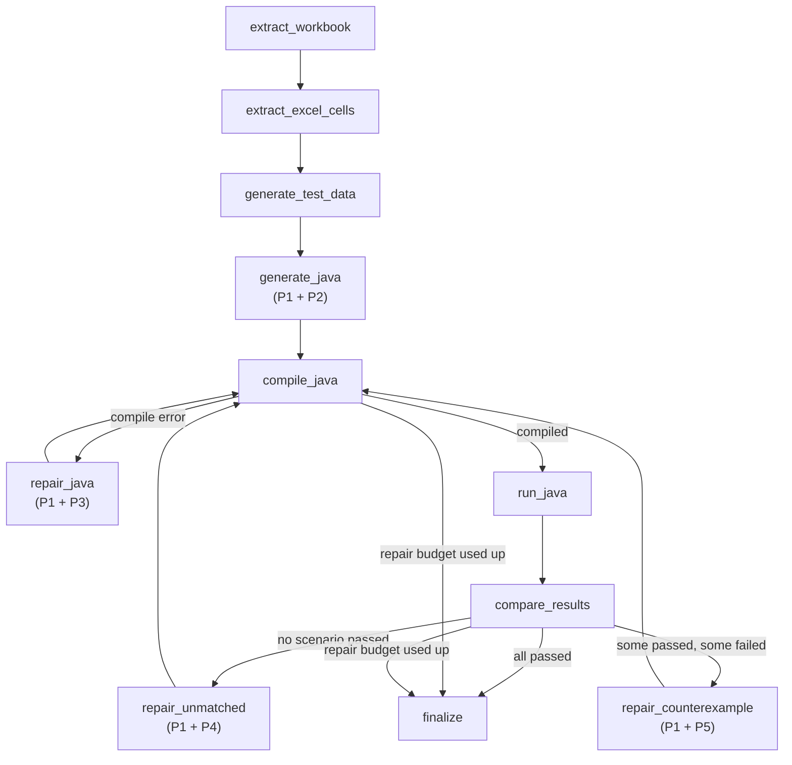

# Prompts Used in the A1 Implementation

This folder contains the LLM prompts used by the **A1** implementation to convert Excel workbooks into equivalent Java programs and refine them over repeated attempts. Text in `{curly_braces}` is a placeholder that the workflow fills in at run time.

## 1. Prompt Inventory

| ID | Prompt | File | Workflow node | Triggered when |
|---|---|---|---|---|
| P1 | System Prompt | [01_system_prompt.md](01_system_prompt.md) | all LLM calls | Every LLM request |
| P2 | Initial Java Generation | [02_initial_generation_prompt.md](02_initial_generation_prompt.md) | `generate_java` | First generation attempt |
| P3 | Compile-Error Repair | [03_compile_repair_prompt.md](03_compile_repair_prompt.md) | `repair_java` | `javac` fails |
| P4 | Unmatched-Cell (Mismatch) Repair | [04_unmatched_repair_prompt.md](04_unmatched_repair_prompt.md) | `repair_unmatched` | Program compiles, but **no** scenario passes |
| P5 | Counterexample-Guided Repair | [05_counterexample_repair_prompt.md](05_counterexample_repair_prompt.md) | `repair_counterexample` | **Some** scenarios pass and **some** fail |

## 2. Where the Prompts Fit in the Workflow

